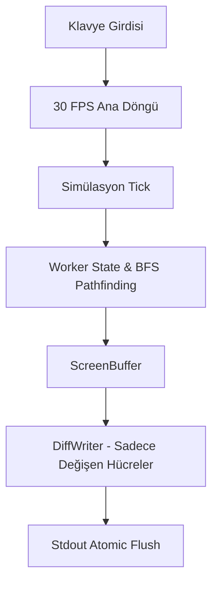

# 🏛️ Architecture (OfficeManagerTui)

OfficeManagerTui, Windows Terminal ve modern terminallerde çalışan 24-bit TrueColor destekli bir ofis ve şirket yönetim simülasyonudur.

## 1. Katman Mimarisi
* **Presentation (Görsel Sunum & Render):**
  * `renderer.py`: Çift tamponlu (double-buffered) `ScreenBuffer`, diferansiyel `DiffWriter` ve yüzen parçacıklar.
  * `colors.py`: 24-bit TrueColor RGB ANSI paleti, VT100 etkinleştirme.
* **Domain / Simulation (İş Mantığı & Dünya):**
  * `simulation.py`: Şirket sermayesi, gelir-gider dengesi, sprint/proje yönetimi ve ofis olayları motoru.
  * `worker.py`: Çalışan yapay zekası, durum makinesi (WORKING, COFFEE, BURNOUT vb.) ve ihtiyaçlar.
  * `office_map.py`: 30x12 ızgara haritası, nesne yerleşimi ve BFS yol bulucu.
* **Runtime / Entry:**
  * `main.py`: 30 FPS ana döngü, klavye girişi ve modal yönetimi.

## 2. Veri Akışı

## 3. Mimari Kurallar
* **Sıfır Bağımlılık:** Yalnızca Python 3 standart kütüphanesi kullanılır.
* **Titreşimsiz Çizim:** Ekran `clear` edilmez; yalnızca fark basılır.
